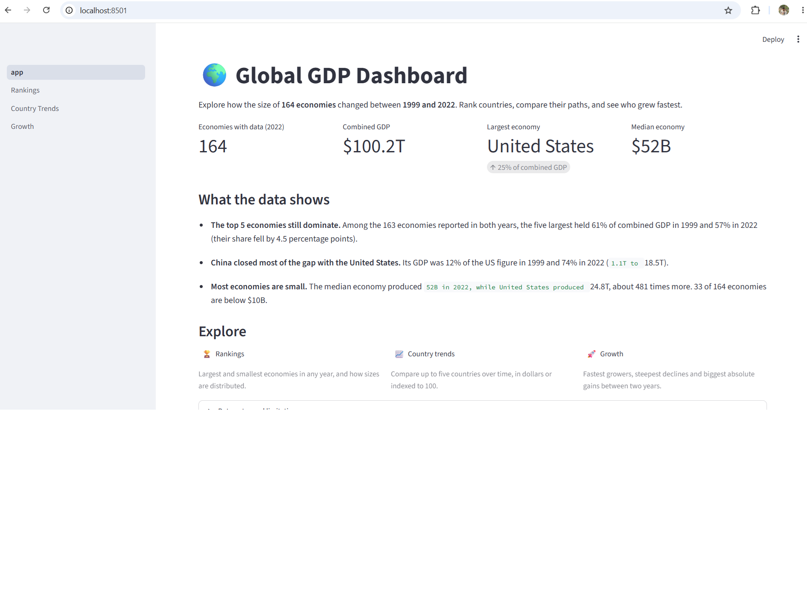

# 🌍 Global GDP Dashboard

An interactive Streamlit dashboard for exploring how the size of **180 economies** changed between **1999 and 2022**: rank countries, compare their growth paths, and find the fastest growers and biggest decliners.

**Live demo:** [ADD YOUR STREAMLIT APP LINK HERE]([https://your-app-name.streamlit.app](https://global-gdp-dashboard-czwyef3ueey6cscv4ger97.streamlit.app/))





## What you can do

| Page | What it answers |
|---|---|
| **Home** | Headline numbers and three findings, calculated live from the data |
| **Rankings** | Which economies are largest or smallest in any year, and how sizes are distributed (log-scale histogram) |
| **Country trends** | How up to five countries compare over time, in dollars or indexed to 100, with an optional log scale |
| **Growth** | Fastest-growing, shrinking and biggest absolute gainers between any two years, with a minimum-size filter |

Every table can be downloaded as CSV.

## Findings

- Among the 163 economies reported in both 1999 and 2022, the five largest held **61%** of combined GDP in 1999 and **57%** in 2022.
- China's GDP rose from **12%** of the United States' in 1999 to **74%** in 2022.
- The median economy in 2022 produced about **$52B**, roughly 480 times less than the United States. 33 of 164 economies are below $10B.
- Between 2015 and 2022 (economies above $10B in 2015), China and the United States each added about $7 trillion. The ten biggest gainers account for **74%** of all new GDP, and 12 of 121 economies shrank.

## Data

- **Source:** Kaggle
- **Unit:** nominal GDP in US$ billions (edit `UNIT` in `data.py` if your source says otherwise).
- **Coverage:** 180 economies, 1999 to 2022 (2011 is missing from the source file).

### Cleaning decisions (and why)

| Problem in the raw file | What I did |
|---|---|
| `0` is used for "not reported" (123 cells across 19 countries, e.g. Afghanistan, Iran, Yemen) | Treated as missing. Otherwise those countries would appear to have zero GDP and would top every "smallest economies" chart. |
| Numbers stored as text with thousands separators (`"1,039.69"`) | Parsed to numbers while reading the file. |
| 2011 column absent | Added as an empty year so lines show a gap instead of a straight line across it. |
| Abrupt jump between 2014 and 2015: 31 countries rise by more than 30% and 18 fall by more than 30% in that one step, while no other year pair checked shows anything similar | Likely two data releases joined together. Charts mark the break, and the Growth and Trends pages warn when a period crosses it. |
| IMF-style names such as `Korea` or `Gambia, The` | Renamed (e.g. South Korea, Gambia) so they read naturally in charts. |

### Limitations

- Latest years may be estimates rather than final figures.
- Nominal GDP in US dollars moves with exchange rates, so a currency crash can look like an economic collapse.
- GDP size says nothing about living standards. A per-capita or inflation-adjusted view would be a useful extension.

## Run it locally

```bash
git clone https://github.com/<your-username>/<your-repo>.git
cd <your-repo>
python -m venv .venv
.venv\Scripts\activate          # Windows  (macOS/Linux: source .venv/bin/activate)
pip install -r requirements.txt
streamlit run app.py
```

Run the tests with `python -m pytest`.

## Project structure

```
├── app.py                 # home page: headline numbers and findings
├── pages/
│   ├── 1_Rankings.py
│   ├── 2_Country_Trends.py
│   └── 3_Growth.py
├── data.py                # loading, cleaning and calculations (plain pandas, tested)
├── utils.py               # cached loader and shared chart styling
├── data/GDP.csv
├── tests/test_data.py
├── requirements.txt
└── .streamlit/config.toml
```

## Tech stack

Python, Streamlit, pandas, Plotly.

## Ideas for next steps

- Add GDP per capita and inflation-adjusted GDP.
- Add a world map view.
- Replace the CSV with a live source such as the World Bank API.

## License

MIT, see [LICENSE](LICENSE).
